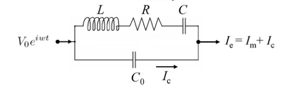
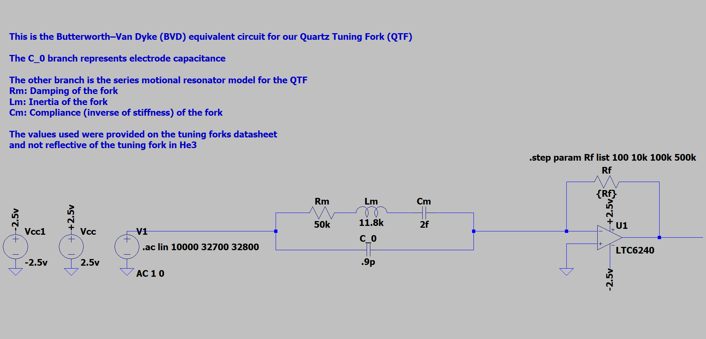
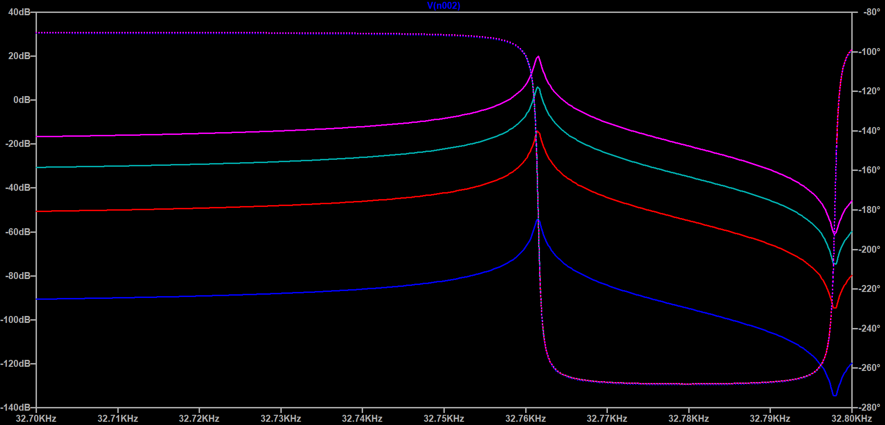
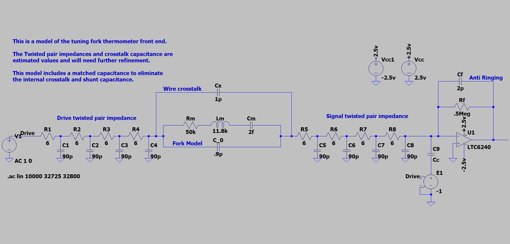
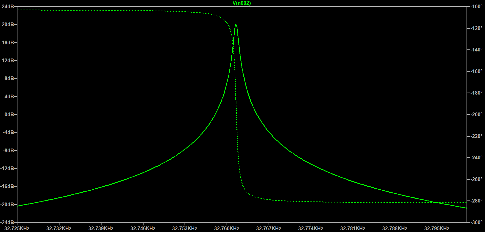
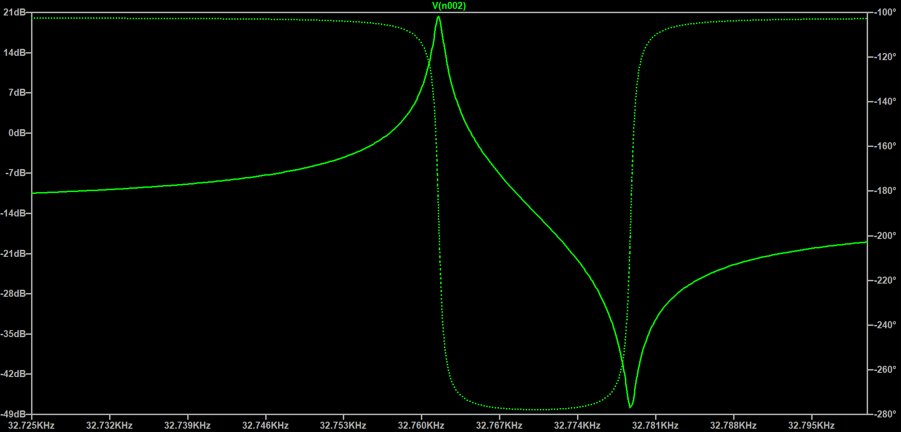
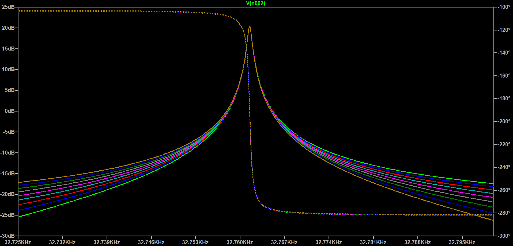
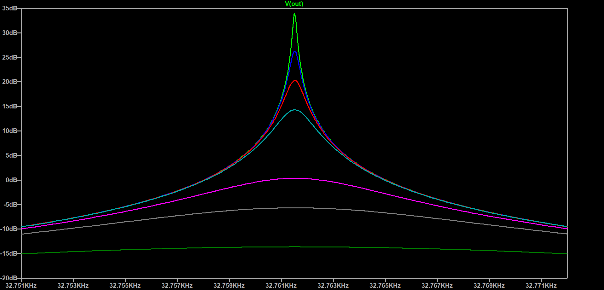
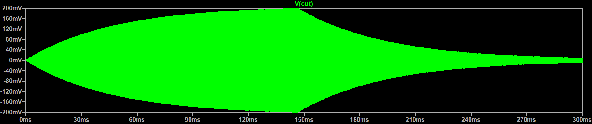

# Resonant Tuning Fork Thermometry — Readout Electronics

Colorado School of Mines Capstone project F26-4.3, sponsored by Maybell Quantum.

## Goal

Develop a manufacturable, self-contained thermometer that uses a quartz tuning
fork immersed in liquid ³He/⁴He to measure the temperature of a dilution
refrigerator cooling plate down to **7 mK**, accurate to **±1 mK**, with a new
reading at least every **30 s**.

This repository holds the readout side of the system: the electronics that drive
the fork, measure its resonant response, and convert it to a temperature.

## Key requirements

| Requirement | Target |
| --- | --- |
| Accuracy at lower limit | ±1 mK |
| Lower measurement limit | 7 mK |
| Polling interval | < 30 s (stretch: < 10 s) |
| Displayed values | Drive voltage, response current, frequency, temperature |
| Integration | Secondary equipment rack, existing power supplies |
| Calibration | Method for fork-to-fork manufacturing variance |
| Environment | Reliable at mK temperatures and fields up to 14 T |
| In-fridge impact | Minimal EMI/noise and heat load from wiring |

## System overview

- **Helium Thermometry Cell (HTC):** sealed cell holding the He mixture and the tuning fork.
- **Readout device:** drives the fork, measures its response, computes and displays temperature.
- **Interconnect:** low-noise, low-heat-load wiring between the HTC and the readout.

## Repository layout

- `hardware/pcb/` — readout schematic and layout (KiCad)
- `hardware/datasheets/` — component datasheets
- `sim/` — LTspice simulations
  - `ltspice/` — schematics (`.asc`), netlists, plot settings
  - `data/` — exported waveforms/results (CSV/TXT)
  - `images/` — plots and screenshots
- `signal-processing/` — MATLAB signal processing
  - `scripts/` — `.m` / `.mlx` code
  - `data/` — input and processed data
  - `figures/` — generated plots
- `cad/` — mechanical CAD and production files
  - `models/` — part and assembly models
  - `production/` — fabrication and assembly outputs (Gerbers, drawings, BOMs)
- `firmware/` — readout interface code
- `docs/` — project plan, requirements, meeting notes
- `test/` — validation and calibration data

## Simulation

### Tuning fork model

The quartz tuning fork is modeled electrically with the Butterworth–Van Dyke
equivalent circuit:

- **Motional branch (L, R, C in series):** represents the fork's mechanical
  resonance. L corresponds to the effective mass of the tines, C to their
  stiffness, and R to the damping (energy lost to the surrounding fluid and
  internal losses). This branch carries the motional current Im.
- **Parallel capacitance C0:** the static capacitance of the fork's
  electrodes and leads, which carries the background current Ic.
- **Drive and response:** the fork is driven with an AC voltage
  V0eiωt, and the measured output is the total current
  Ie = Im + Ic.

The motional branch resonates at f0 = 1 / (2π√(LC)) with quality
factor Q = (1/R)√(L/C). In liquid helium, the fluid's density adds effective
mass (lowering f0) and its viscosity adds damping (raising R and
widening the resonance). Because the viscosity of the ³He/⁴He mixture depends
on temperature, the resonance frequency and width measured from Ie
give the temperature.

### Circuit parameters

The L, R, C values are approximated from the fork's mechanical properties
using the model of Blaauwgeers et al. (2007), *Quartz Tuning Fork:
Thermometer, Pressure- and Viscometer for Helium Liquids*:

$$F_0 = \frac{a}{2}\,U_0$$

$$R = \frac{2m\gamma}{a^2}, \qquad L = \frac{2m}{a^2}, \qquad C = \frac{a^2}{2k}$$

Nominal values for the fork:

| Element | Value |
| --- | --- |
| R (R₁) | 50 kΩ (max) |
| L (L₁) | ≈ 11.8 kH |
| C (C₁) | 2.0 fF |
| C₀ | 0.9 pF, plus cable capacitance |

The fork constant is

$$a = \sqrt{\frac{2m\,\Delta\omega}{R}}$$

where F0 is the driving force on the prongs, U0 the drive
voltage amplitude, m the effective prong mass, k the prong spring constant,
γ the damping, and Δω the resonance width (angular frequency).

### Transimpedance readout (LTspice)

Schematic: [`sim/ltspice/TuningForkModel.asc`](sim/ltspice/TuningForkModel.asc)

The BVD model (Rm = 50 kΩ, Lm = 11.8 kH,
Cm = 2 fF, C0 = 0.9 pF, datasheet values, not values in
³He) is driven by a 1 V AC source, and its output current goes into an LTC6240
transimpedance amplifier on ±2.5 V supplies. No noise sources are included.
An AC sweep from 32.70 kHz to 32.80 kHz is stepped over feedback resistances
Rf = 100 Ω, 10 kΩ, 100 kΩ, and 500 kΩ.

The output voltage is Vout = −IeRf, so each
trace converts to fork current using its known Rf. All traces show
the series resonance near 32.761 kHz and the anti-resonance from C0
near 32.798 kHz; the peak output scales with Rf (about −54 dB at
100 Ω up to about +20 dB at 500 kΩ). At the peak, the 10 kΩ trace
(≈ −14 dB ≈ 0.2 V) corresponds to ≈ 20 µA, which matches 1 V / Rm.

### Full front end (LTspice)

Schematic: [`sim/ltspice/TuningFork_FrontEnd_Model.asc`](sim/ltspice/TuningFork_FrontEnd_Model.asc)
(netlist: [`TuningFork_FrontEnd_Model.net`](sim/ltspice/TuningFork_FrontEnd_Model.net))

This model adds the wiring between the readout and the fork in the fridge:

- **Twisted pairs:** the drive and signal lines are each modeled as four RC
  sections (6 Ω, 90 pF per section). These values are estimates.
- **Wire crosstalk:** Cx = 1 pF between the drive and signal lines (estimate).
- **TIA:** LTC6240 on ±2.5 V, Rf = 500 kΩ, with Cf = 2 pF
  across it to prevent ringing.
- **Shunt compensation:** an inverted copy of the drive (E1, gain −1) is fed
  into the TIA input through Cc = 1.9 pF, matched to
  C0 + Cx. This cancels the current through the fork's
  electrode capacitance and the wire crosstalk, so only the motional current
  reaches the amplifier.

With compensation, the response is a symmetric resonance peaking at about
+20 dB near 32.762 kHz, with a clean 180° phase transition through resonance.

Without Cc, the 1.9 pF of shunt capacitance pulls the
anti-resonance in to about 32.779 kHz and skews the resonance:

Sweeping the crosstalk estimate Cx about ±0.5 pF around 1 pF, with
Cc fixed at 1.9 pF, shows the effect of a compensation mismatch. The
resonance peak (≈ +20 dB at 32.762 kHz) is unchanged, while the off-resonance
level shifts by up to about ±4 dB and the response becomes asymmetric:

Sweeping Rm models the increased damping of the fork as the helium
viscosity rises at lower temperatures. For Rm = 10k, 25k, 50k, 100k,
500k, 1Meg, and 2.5Meg, the resonance frequency stays at about 32.761 kHz while
the peak drops from about +34 dB to −13.5 dB and the resonance broadens, since
the peak motional current is Vdrive/Rm:

Transient response of the front end to a 0.2 V drive burst at resonance
(32.761 kHz) lasting 0.15 s, with Rm = 500 kΩ and Rf = 500 kΩ.
The output rings up to a peak of about 0.2 V while driven and rings down after
the drive stops, both with a time constant of about 47 ms
(τ = 2Lm/Rm). Later models must account for this: after
each change in drive frequency, the fork needs several time constants
(about 5τ ≈ 0.25 s here) to settle before a new measurement can begin.

#### Ring-down time (analytical)

With the drive removed, Kirchhoff's voltage law around the fork's motional branch gives

$$L_m \frac{d^2 i}{dt^2} + R_m \frac{di}{dt} + \frac{i}{C_m} = 0$$

Substituting $i = e^{st}$ gives the characteristic equation $L_m s^2 + R_m s + 1/C_m = 0$, with roots

$$s = -\frac{R_m}{2L_m} \pm j\sqrt{\frac{1}{L_m C_m} - \left(\frac{R_m}{2L_m}\right)^2} \approx -\frac{R_m}{2L_m} \pm j\omega_0$$

since $R_m/2L_m \ll \omega_0$. The current therefore oscillates at $f_0$ inside an exponentially decaying envelope:

$$i(t) = I_0 \, e^{-t/\tau} \cos(\omega_0 t + \phi), \qquad \tau = \frac{2L_m}{R_m}$$

When the fork is driven on resonance from rest, the envelope rises as $I_\infty\left(1 - e^{-t/\tau}\right)$ with the same $\tau$. The time constant is tied to the resonance width $\Delta f$ (full width at half power) and the quality factor:

$$\Delta f = \frac{R_m}{2\pi L_m}, \qquad \tau = \frac{1}{\pi \Delta f}, \qquad Q = \frac{\omega_0 L_m}{R_m} = \pi f_0 \tau$$

For $L_m = 11.8$ kH, $C_m = 2.0$ fF and $R_m = 500$ kΩ:

| Quantity | Value |
|---|---|
| $f_0 = 1/(2\pi\sqrt{L_m C_m})$ | 32 761.5 Hz |
| $\tau = 2L_m/R_m$ | 47.2 ms |
| $\Delta f = R_m/(2\pi L_m)$ | 6.74 Hz |
| $Q = \omega_0 L_m/R_m$ | 4 858 |
| Steady-state peak, $V_d R_f/R_m \cdot 1/\sqrt{1+(\omega_0 R_f C_f)^2}$, with $V_d$ = 0.2 V, $R_f$ = 500 kΩ, $C_f$ = 2 pF | 0.196 V |

These match the simulated transient (peak ≈ 0.2 V, τ ≈ 47 ms). After a change in drive frequency the leftover transient falls to $e^{-n}$ after $n\tau$, so waiting 5τ (236 ms here) leaves 0.7%.

## Status

Requirements phase. LTspice front-end model (fork, twisted-pair wiring, crosstalk, shunt compensation, TIA) complete; MATLAB signal processing next.

## Team

Evan Christie, Enzo Guglielmo, Nathan Johnston, Ryan Montoya, Zurin Trzaska,
Anastasiia Usmanova. Project advisor: Eric Brighton.
