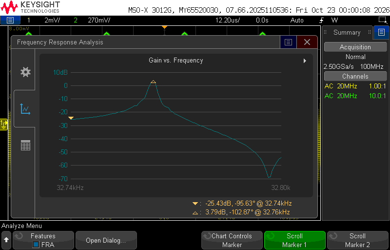

# Resonant Tuning Fork Thermometry — Readout Electronics

Colorado School of Mines Capstone project F26-4.3, sponsored by Maybell Quantum.

## Goal

Develop a manufacturable, self-contained thermometer that uses a quartz tuning
fork immersed in liquid ³He/⁴He to measure the temperature of a dilution
refrigerator cooling plate down to **7 mK**, accurate to **±1 mK**, with a new
reading at least every **30 s**.

This repository holds the readout side of the system: the electronics that drive
the fork, measure its resonant response, and convert it to a temperature.

## Key requirements

| Requirement | Target |
| --- | --- |
| Accuracy at lower limit | ±1 mK |
| Lower measurement limit | 7 mK |
| Polling interval | < 30 s (stretch: < 10 s) |
| Displayed values | Drive voltage, response current, frequency, temperature |
| Integration | Secondary equipment rack, existing power supplies |
| Calibration | Method for fork-to-fork manufacturing variance |
| Environment | Reliable at mK temperatures and fields up to 14 T |
| In-fridge impact | Minimal EMI/noise and heat load from wiring |

## System overview

- **Helium Thermometry Cell (HTC):** sealed cell holding the He mixture and the tuning fork.
- **Readout device:** drives the fork, measures its response, computes and displays temperature.
- **Interconnect:** low-noise, low-heat-load wiring between the HTC and the readout.

## Repository layout

- `hardware/pcb/` — readout schematic and layout (KiCad)
- `hardware/datasheets/` — component datasheets
- `sim/` — LTspice simulations
  - `ltspice/` — schematics (`.asc`), netlists, plot settings
  - `data/` — exported waveforms/results (CSV/TXT)
  - `images/` — plots and screenshots
- `signal-processing/` — MATLAB signal processing
  - `scripts/` — `.m` / `.mlx` code
  - `data/` — input and processed data
  - `figures/` — generated plots
- `cad/` — mechanical CAD and production files
  - `models/` — part and assembly models
  - `production/` — fabrication and assembly outputs (Gerbers, drawings, BOMs)
- `firmware/` — readout interface code
- `docs/` — project plan, requirements, meeting notes
- `test/` — validation and calibration data

## Simulation

Full details, plots, and derivations are in [`sim/README.md`](sim/README.md).

- **Fork model:** Butterworth–Van Dyke equivalent circuit (Rm = 50 kΩ,
  Lm ≈ 11.8 kH, Cm = 2.0 fF, C0 = 0.9 pF),
  resonance at about 32.761 kHz.
- **Front end (LTspice):** twisted-pair wiring, wire crosstalk, shunt
  compensation (Cc = C0 + Cx), and an LTC6240
  transimpedance amplifier (Rf = 500 kΩ).
- **Key results:** compensation gives a clean, symmetric resonance; the fork
  rings up and down with τ = 2Lm/Rm ≈ 47 ms at
  Rm = 500 kΩ, so each frequency step needs about 0.25 s to settle.

## Measurements

Bench results are in [`test/README.md`](test/README.md). First measurement: the fork read out through the TIA with no anti-ringing capacitor, peaking at +3.79 dB at 32.76 kHz.

## Status

Requirements phase. LTspice front-end model (fork, twisted-pair wiring, crosstalk, shunt compensation, TIA) complete; MATLAB signal processing next.

## Team

Evan Christie, Enzo Guglielmo, Nathan Johnston, Ryan Montoya, Zurin Trzaska,
Anastasiia Usmanova. Project advisor: Eric Brighton.
