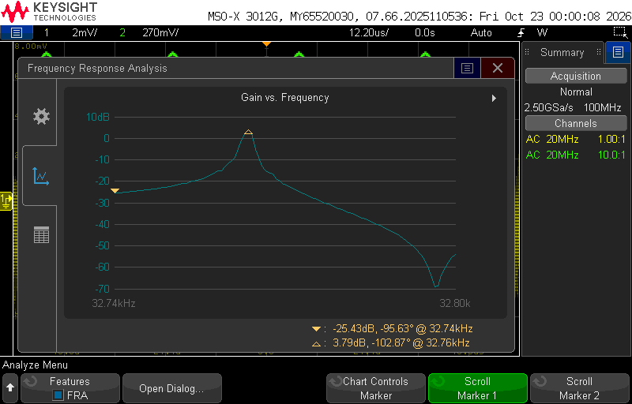

# Test

Bench measurements of the tuning fork and readout electronics.

## Fork with TIA, no anti-ringing capacitor

Frequency response of the tuning fork read out through the transimpedance
amplifier with no Cf across Rf, measured with the
frequency response analysis (FRA) function of a Keysight MSO-X 3012G from
32.74 kHz to 32.80 kHz. The response peaks at +3.79 dB (−102.87°) at
32.76 kHz, sits at −25.43 dB at 32.74 kHz, and falls to an anti-resonance
notch of about −69 dB near 32.796 kHz.

